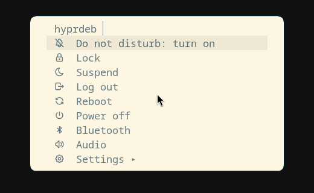
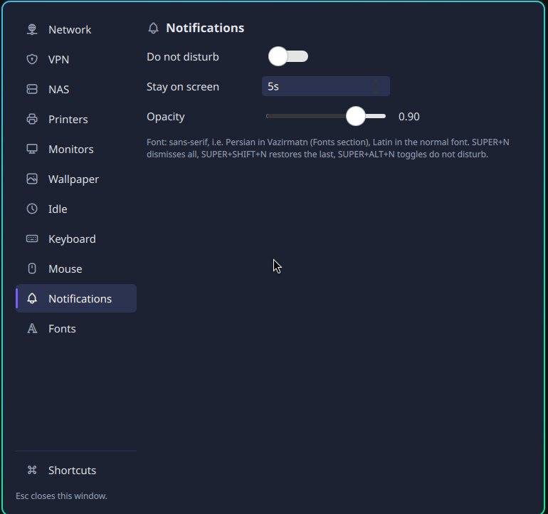
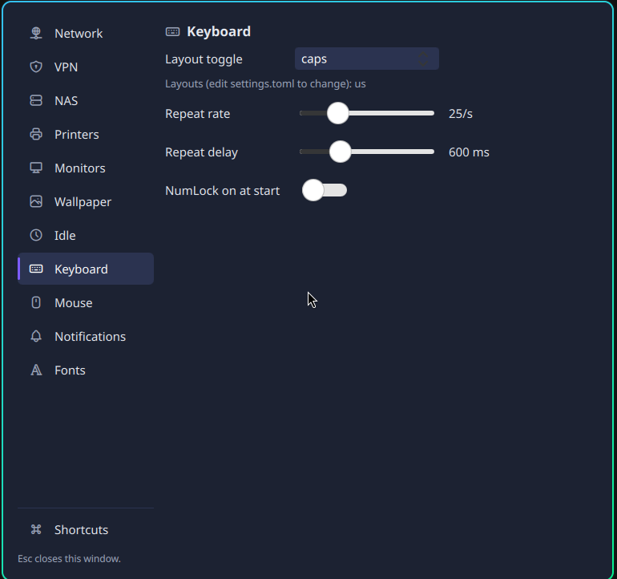
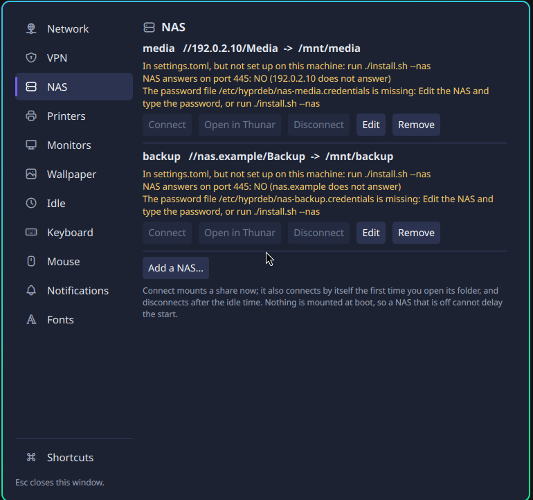

# hyprdeb

A reproducible [Hyprland](https://hypr.land) desktop for **Debian 13 (trixie)**: package lists, configuration, a settings
file with a small command-line tool and a settings window, and an idempotent installer, all in one repository.

- **One settings file.** `~/.config/hyprdeb/settings.toml` is the only file you edit. `hyprdeb apply` turns it into the
  Hyprland, hypridle, hyprpaper, mako and fontconfig files; the settings window (`hyprdeb gui`) edits the same file.
- **Safe to re-run.** Every installer stage checks the current state first and changes nothing if it is already right.
  `./install.sh --dry-run` prints what would happen and changes nothing.
- **Nothing hidden in your files.** Managed text sits between markers (or in files that say "hyprdeb managed" on top);
  everything outside is never touched. `settings.toml` is created once and then belongs to you.
- **Risky changes are opt-in and reversible.** Login screen, NetworkManager, NAS and printing are separate flags, each with
  a way back (see [docs/recovery.md](docs/recovery.md)).

> Status: early, used daily by its author on one desktop PC. Read [Known limits](#known-limits) before you run it on a
> machine you cannot afford to repair.

## What you get

| Area | What |
|---|---|
| Compositor | Hyprland 0.55 from `trixie-backports` (Lua configuration), hyprlock, hypridle, hyprpaper, hyprlauncher |
| Desktop | waybar, mako notifications, a quick menu (`SUPER+Escape`), a searchable shortcuts window (`SUPER+/`), clipboard history, screenshots with swappy |
| Settings window | Quickshell window with a sidebar: Network, VPN, NAS, Printers, Monitors, Wallpaper (per-monitor, slideshow, lock screen), Idle, Keyboard, Mouse, Notifications, Fonts |
| Apps | kitty, Thunar, Chrome (optional), Firefox ESR fallback, Kate, OBS, mpv; Flatpak apps are opt-in |
| Opt-in | NVIDIA driver, VS Code, Flatpak, OBS virtual camera, greetd login screen, NetworkManager, NAS shares, printing, local virtual machines (libvirt + virt-manager), Claude Desktop prerequisites |

## Screenshots

Taken in a virtual machine (1280x800).

| Quick menu (`SUPER+Escape`) | Settings window: Notifications |
|---|---|
|  |  |

| Settings window: Keyboard | Settings window: NAS |
|---|---|
|  |  |

## Requirements

- **Debian 13 "trixie"**, a fresh or lightly used install. The installer refuses other releases.
- A user in the `sudo` group. System stages ask for sudo; user stages (`--config-only`) never do.
- Network access to the Debian mirrors (the installer adds `contrib`, `non-free` and `trixie-backports`).
- Hyprland 0.55 comes from backports; its configuration is written in Lua. Other Hyprland versions are not supported.
- Tested on: Debian 13.7 on a desktop PC with an NVIDIA RTX 3050 (driver 550) and two monitors, and in a QEMU/KVM virtual
  machine with virtio-gpu. Other hardware is untested.

## Install

```bash
git clone https://github.com/dani-io/hyprdeb.git
cd hyprdeb
./install.sh --dry-run          # read what it will do
./install.sh                    # system packages and user config (asks for sudo)
# add what you need:  --nvidia  --flatpak  --vscode  --virtualcam  --virt  --timezone Europe/Berlin
```

Log in on a text console and start the session with `start-hyprland`, or enable the optional login screen with
`./install.sh --greeter` (see [docs/recovery.md](docs/recovery.md) first).

`./install.sh --list-stages` shows every stage, whether it needs sudo and which flag turns on the opt-in ones.
`./install.sh --only icons,kitty` runs just those stages; `./install.sh --config-only` (= `--only user`) re-deploys the user
configuration without sudo. Run any of them again at any time.

### Stages that change something important

| Flag | What it does | Read first |
|---|---|---|
| `--greeter` | greetd with the tuigreet text login screen on VT 7, active from the next boot | [recovery](docs/recovery.md#login-screen-greetd) |
| `--networkmanager` | moves the wired connection from ifupdown/dhcpcd to NetworkManager, with the same DHCP client id and an automatic rollback timer | [recovery](docs/recovery.md#networkmanager) |
| `--nas` | installs the root helper behind the NAS page and sets up the shares in `settings.toml` | [security](SECURITY.md), [architecture](docs/architecture.md#root-helpers) |
| `--virt` | libvirt + virt-manager with the default NAT network (no LAN bridge); guests are shut down, not suspended, when the host shuts down | [virt](docs/virt.md) |
| `--printing` | CUPS (no avahi, no cups-browsed) and one printer queue from `[printing]` | [printing](docs/printing.md) |
| `--nvidia` | the proprietary driver and the options Wayland needs across suspend | [gotchas](docs/gotchas.md#nvidia) |
| `--cowork` | QEMU, the `kvm` group and `vhost_vsock` for Claude Desktop's Cowork VM (Claude Desktop itself is not installed) | [gotchas](docs/gotchas.md#claude-desktop-cowork) |

Chrome and VS Code come from the vendors' own apt repositories (the installer checks Microsoft's key against its published
fingerprints; Google's key is fetched over HTTPS). Chrome is on by default (`--no-chrome` skips it), VS Code is `--vscode`.

## Settings

```bash
hyprdeb show                       # effective settings, defaults filled in
hyprdeb get idle.lock_after
hyprdeb set idle.lock_after 15m    # writes settings.toml (comments kept) and applies it
hyprdeb check                      # validate settings.toml, print what would be generated
hyprdeb gui                        # the settings window; `hyprdeb gui --page nas` opens one page
```

The template [`config/hyprdeb/settings.toml`](config/hyprdeb/settings.toml) lists every key as a comment with its default.
Unknown keys and wrong values are errors, never silently ignored. A reference of the sections is in
[docs/settings.md](docs/settings.md).

Keyboard layout defaults to **US only**. For another layout, add for example:

```toml
[keyboard]
layouts  = ["us", "ir"]        # the first one must be Latin: the lock screen switches to layout 0
variants = ["", "winkeys"]
toggle   = "caps"              # caps, alt_shift or win_space
```

### Some things worth knowing

- **Lock and idle:** `SUPER+L` locks; the screen locks after 10 minutes and turns off after 15 (`[idle]`).
- **Network page:** shows the uplink and runs quick checks (gateway, DNS, internet). With NetworkManager installed you can
  switch DHCP/static addresses and DNS; every change is armed with an automatic revert after 60 s unless you confirm it.
- **VPN:** import a WireGuard `.conf` once (`hyprdeb vpn import FILE.conf --name NAME`); the key is stored only in the
  NetworkManager profile. `vpn on|off` and a waybar indicator; never on at boot.
- **NAS:** several CIFS/SMB shares, each a systemd automount on `/mnt/NAME` (mounted on first access, never at boot, never
  in fstab). The password is typed in the window, goes to a small root helper after a polkit password dialog and is kept only in a
  root-only file; it is never in `settings.toml`, a log or a command line.
- **Printing:** driverless IPP, any vendor's PPD, or a documented Canon example: [docs/printing.md](docs/printing.md).
- **Fonts:** `[fonts] persian` picks one family for Arabic-script text on the whole desktop (default Vazirmatn); Latin text
  keeps its own font.

## Repository layout

```
install.sh            the installer (stages, --dry-run, --only, --list-stages)
packages/*.list       apt package lists, one per area
bin/                  hyprdeb (CLI), hyprdeb-lock, hyprdeb-nas and hyprdeb-net-guard (root helpers), hyprdeb-session, hyprdeb-nm
config/hypr/          Hyprland Lua blocks and hyprlock/hypridle/hyprpaper configs
config/hyprdeb/       settings template, generated-file defaults, the Quickshell windows (gui/)
config/systemd/, polkit/, greetd/, modprobe/, sysctl/   root-owned files for the opt-in stages
assets/               generated default wallpaper, the Tabler icon font
docs/                 architecture, gotchas, recovery, printing, virtual machines, settings reference
```

## Known limits

- Hyprland 0.55 only, on Debian 13 only. No Ubuntu, no Arch, no other releases.
- One user's daily setup: expect rough edges on other hardware, especially multi-GPU, laptops (no battery or touchpad
  settings yet) and Wi-Fi uplinks (the NetworkManager stage refuses them).
- The NVIDIA stage needs Secure Boot off (or an enrolled key); the DKMS module will not load otherwise.
- The settings window is a Quickshell window (Debian's quickshell package), not a shell replacement.
- There is no uninstall command. Config files are backed up once before they are replaced, managed blocks can be deleted by
  hand, and the opt-in system stages document their way back in [docs/recovery.md](docs/recovery.md).

## Security

The root helpers (`hyprdeb-nas`, `hyprdeb-net-guard`) and what they accept are described in [SECURITY.md](SECURITY.md), which
also says how to report a problem.

## Credits and licence

- Inspired by [Omarchy](https://github.com/basecamp/omarchy) and Ryoku. No code is shared with either.
- Icons: [Tabler Icons](https://tabler.io/icons) (outline, MIT, © Paweł Kuna), vendored as a font in
  `assets/fonts/tabler-icons/` with its own licence.
- hyprdeb itself is released under the [MIT licence](LICENSE).
